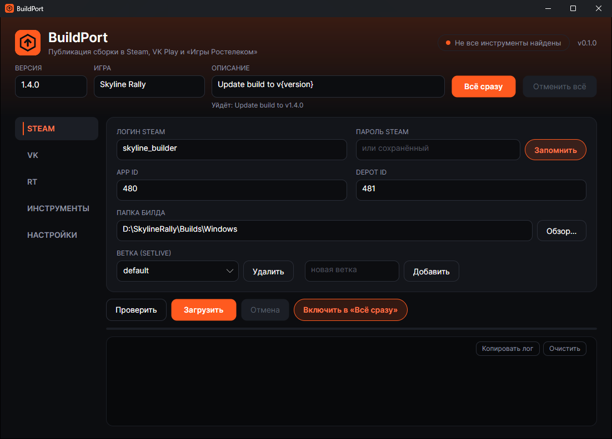
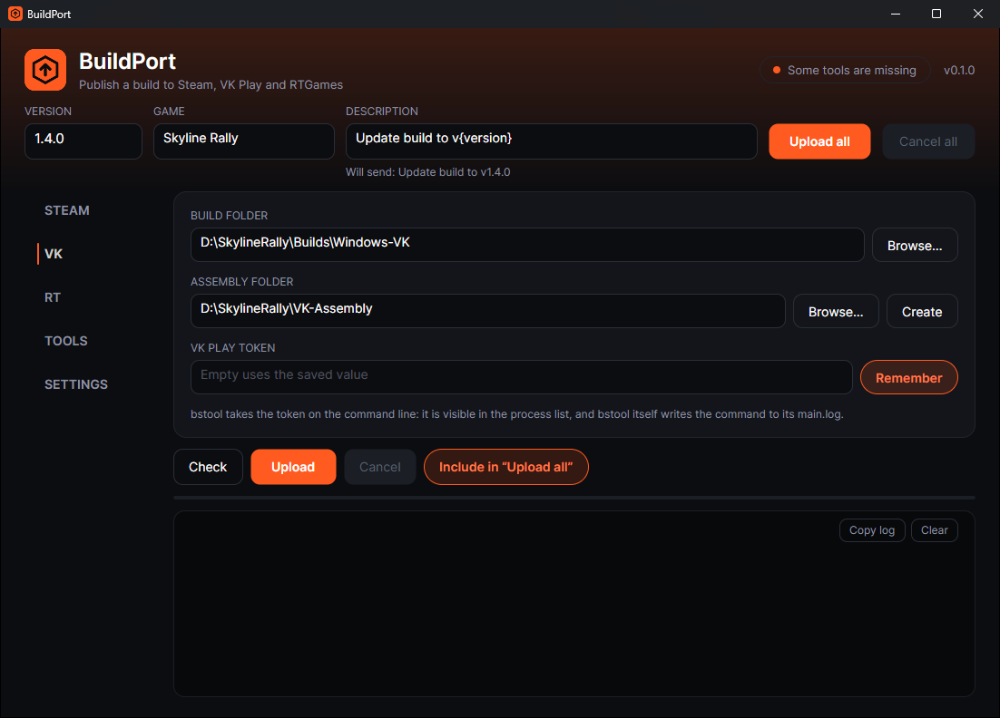
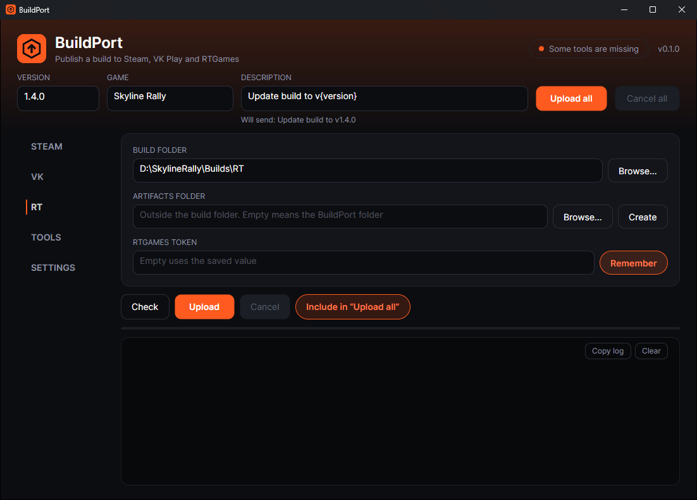
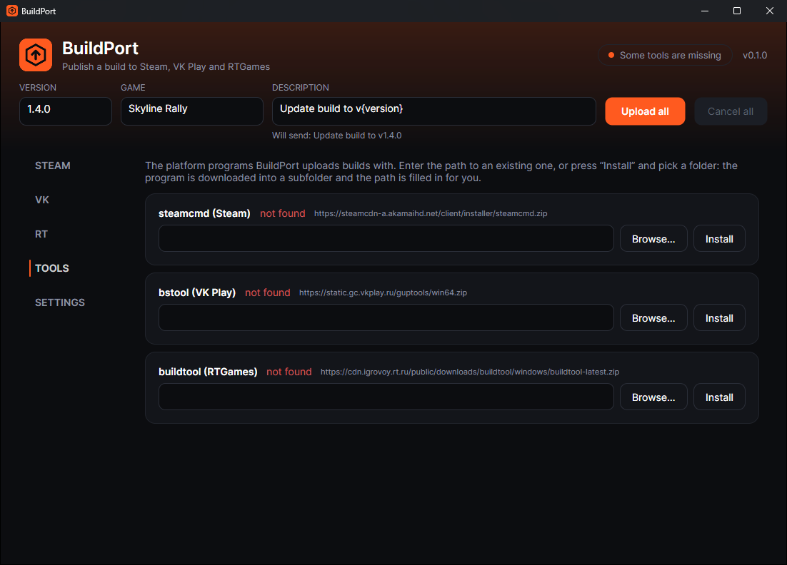
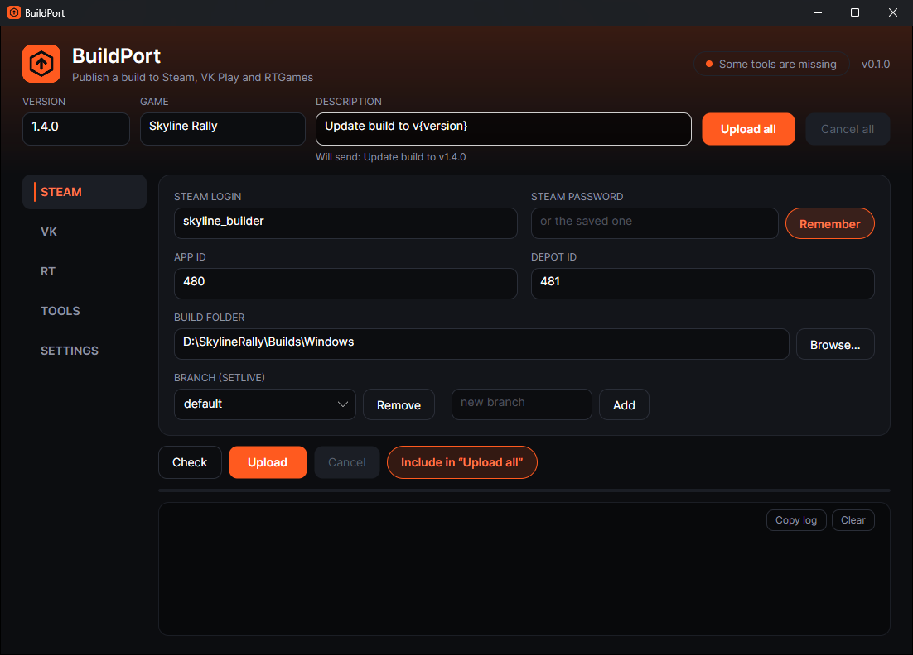

<div align="center">


# BuildPort

**Один манифест, одна команда, все сторы.**

Публикация билда игры в Steam, VK Play, «Игры Ростелеком», Яндекс.Диск, Google Drive и на свой сервер
из одного окна или одной командой — версия задаётся в одном месте, а секреты никогда не лежат на диске открытым текстом.

[](https://github.com/JeffectH/BuildPort-releases/releases/latest)
[](https://github.com/JeffectH/BuildPort-releases/releases)


[**Скачать**](#скачать) · [Возможности](#возможности) · [Быстрый старт](#быстрый-старт) · [Сообщить об ошибке](https://github.com/JeffectH/BuildPort-releases/issues/new/choose) · [English](README.md)



</div>

## Скачать

| | Платформа | Файл |
|---|---|---|
| **Приложение** | Windows 10/11 x64 | [BuildPort-win-x64.zip](https://github.com/JeffectH/BuildPort-releases/releases/latest/download/BuildPort-win-x64.zip) |
| **CLI** | Windows x64 | [buildport-cli-win-x64.zip](https://github.com/JeffectH/BuildPort-releases/releases/latest/download/buildport-cli-win-x64.zip) |
| **CLI** | Linux x64 | [buildport-cli-linux-x64.tar.gz](https://github.com/JeffectH/BuildPort-releases/releases/latest/download/buildport-cli-linux-x64.tar.gz) |

Каждая сборка — один самодостаточный исполняемый файл: без установщика и без отдельной установки .NET.
Контрольные суммы — в `SHA256SUMS.txt` на странице каждого [релиза](https://github.com/JeffectH/BuildPort-releases/releases).
Сборки для macOS появятся позже.

> [!NOTE]
> Файлы пока не подписаны сертификатом, поэтому при первом запуске Windows SmartScreen может показать
> *«Система Windows защитила ваш компьютер»*. Нажмите **Подробнее → Выполнить в любом случае**.
> При сомнениях сверьте файл с `SHA256SUMS.txt`.

## Возможности

- **Все сторы в одном месте.** Steam, VK Play и «Игры Ростелеком» в приложении; в CLI ещё SFTP,
  Яндекс.Диск, Google Drive и любая своя команда.
- **Одна версия везде.** Задаёте один раз — она попадает в описание билда каждого стора, в имя каждого
  архива и в каждый путь на сервере.
- **Секреты под защитой.** Токены и пароли хранятся в хранилище ОС (DPAPI в Windows, Keychain, secret-tool)
  или в переменных окружения для CI. Любое значение вычищается из логов, команд и отчётов.
- **Проверка до загрузки.** Сначала проверяется каждая цель: отсутствующий токен не всплывёт после двадцати
  минут заливки в другой стор.
- **Честные частичные релизы.** Если одна цель из шести упала, остальные пять всё равно уйдут, отчёт покажет,
  что и куда попало, а `--retry-failed` перезапустит только упавшее.
- **Инструменты сторов в один клик.** steamcmd, bstool и buildtool скачиваются с официальных адресов —
  в комплект ничего не вшито.
- **Steam Guard.** Код запрашивается в диалоге, когда он нужен steamcmd.
- **Интерфейс на русском и английском.**

## Скриншоты

<table>
  <tr>
    <td></td>
    <td></td>
  </tr>
  <tr>
    <td align="center">VK Play</td>
    <td align="center">«Игры Ростелеком»</td>
  </tr>
  <tr>
    <td></td>
    <td></td>
  </tr>
  <tr>
    <td align="center">Инструменты сторов ставятся в один клик</td>
    <td align="center">Английский интерфейс</td>
  </tr>
</table>

## Быстрый старт

### Приложение

1. Скачайте и распакуйте `BuildPort-win-x64.zip`, запустите `BuildPort.exe`.
2. Откройте **Инструменты** и нажмите **Установить** для нужных сторов (или укажите путь к уже установленным).
3. Заполните версию, название игры и папку билда на вкладке каждого стора.
4. Нажмите **Проверить**, затем **Загрузить** — или **Всё сразу**, чтобы отправить билд во все включённые сторы.

### CLI

Опишите релиз один раз в `release.yaml` и закоммитьте рядом с проектом:

```yaml
version: "1.4.0"
game: "My Game"
description: "Update build to v{version}"

artifacts:
  steam-win:  { path: "Builds/Windows", type: directory }
  public-zip: { from: steam-win, type: zip, file_name_template: "{game}_{version}.zip" }

targets:
  - type: steam
    artifact: steam-win
    app_id: "480"
    depot_id: "481"
    branch: default

  - type: sftp
    artifact: public-zip
    host: "builds.example.com"
    username: "deploy"
    remote_dir: "/var/www/downloads"
    private_key: "keystore:buildport/server/ssh-key"
```

```bash
buildport login steam             # один раз сохранить учётные данные в хранилище ОС
buildport publish --dry-run       # показать точный план и команды, ничего не трогая
buildport publish                 # проверить все цели, затем загрузить
buildport publish --retry-failed  # перезапустить только упавшее
buildport doctor                  # найти недостающие инструменты и токены открытым текстом на диске
```

В манифесте хранятся только *ссылки* на секреты (`keystore:…`, `env:…`), а не сами значения — поэтому его
можно коммитить, и один и тот же файл работает и на вашей машине, и на CI.

## Поддерживаемые цели

| Цель | Приложение | CLI | Примечание |
|---|:---:|:---:|---|
| Steam | ✓ | ✓ | через steamcmd, поддержка Steam Guard |
| VK Play | ✓ | ✓ | через bstool, только Windows |
| «Игры Ростелеком» | ✓ | ✓ | через buildtool, только Windows |
| SFTP / свой сервер | | ✓ | атомарная замена файла |
| Яндекс.Диск | | ✓ | по желанию — публичная ссылка |
| Google Drive | | ✓ | |
| Любая команда | | ✓ | цель `exec` |

## Известное ограничение

`bstool.exe` от VK Play принимает токен аргументом командной строки: он виден в списке процессов,
а сам bstool пишет полную команду в свой лог. BuildPort не может это исправить и не добавляет своих утечек;
`buildport doctor` покажет, где на диске лежат токены открытым текстом.

## Обратная связь

Нашли ошибку или не хватает стора? [Создайте issue](https://github.com/JeffectH/BuildPort-releases/issues/new/choose).
Изменения в каждой версии — в [CHANGELOG.md](CHANGELOG.md).

## Лицензия

BuildPort бесплатен, в том числе для коммерческих проектов. Это программа с закрытым исходным кодом,
распространяется по [лицензии BuildPort](LICENSE.md). steamcmd, bstool и buildtool принадлежат своим
разработчикам и распространяются на их условиях.
